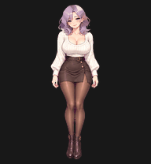

# Лила — анимированный питомец

Утверждённый исходник: `original.png`.

Финальный атлас: `pet/spritesheet.png` — прозрачный PNG 1536×2288, 73 кадра, девять анимаций и 16 направлений взгляда.

- `pet/previews/` — GIF, MP4 и кадры анимаций.
- `pet/qa/` — отчёты проверок и сравнение краёв до/после очистки.
- `pet/source-workflow/` — исходные изображения, промпты imagegen, сгенерированные полосы и извлечённые кадры.
- `pet/pet.json` — идентификатор созданного питомца.

Черновые изображения сохранены для истории; финальный установленный атлас — `pet/spritesheet.png`.

## Дополнительные циклы простоя

Четыре варианта в [`pet/idle-variants`](pet/idle-variants/README.md). Сейчас установлен `body-sway`.

