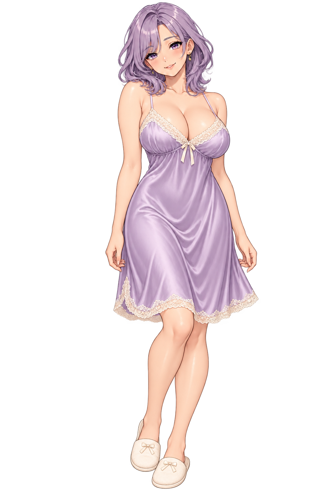

# Ночнушка — примерка образа

Статическое изображение для оценки внешнего вида. Ночной питомец и расписание не изменены по выбору пользователя.

Создано встроенным imagegen по исходному образу Лилы. Итоговое описание: взрослая Лила в лиловой шёлковой ночнушке до колен с кружевной отделкой и мягких тапочках; лицо, волосы и пропорции сохранены.
